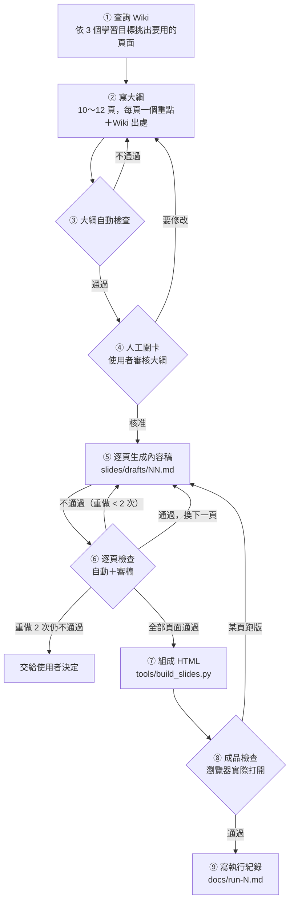

# 簡報流程設計（loop／graph）v1 —— 已由 v2 取代，保留作為比較

> 目標：只用 Wiki 的內容，做出 10～12 頁、讓「用過 ChatGPT 的大學生」看得懂的教學簡報。
> 原則：**每一步都有檢查；沒通過就回到上一步重做，而且只重做出問題的那一部分。**

## 流程圖

## 每個節點做什麼

| 節點 | 輸入 → 輸出 | 誰做 |
|---|---|---|
| ① 查詢 Wiki | `wiki/index.md`、學習目標 → 每個目標要用哪些頁面 | AI（只讀 Wiki，不碰 raw） |
| ② 寫大綱 | 查詢結果 → `slides/outline.md` | AI |
| ⑤ 逐頁生成 | 大綱的一頁＋該頁引用的 Wiki 頁 → `slides/drafts/NN.md` | AI |
| ⑦ 組成 HTML | 所有內容稿 → `slides/index.html` | 程式（不經過 AI，確保成品和內容稿一致） |
| ⑨ 寫紀錄 | 各關卡結果 → `docs/run-N.md` | AI |

## 檢查關卡

| 關卡 | 檢查什麼 | 怎麼檢查 | 不通過時 | 上限 |
|---|---|---|---|---|
| ③ 大綱自動檢查 | 頁數 10～12；每頁有 Wiki 出處而且頁面存在；3 個學習目標都有頁面負責 | `tools/check_outline.py` | 回 ② | 2 次 |
| ④ 人工關卡 | 主線順不順、有沒有漏掉想教的東西、份量 | 使用者 | 依意見回 ② | — |
| ⑥ 逐頁檢查（自動） | 最多 5 個要點、每點 40 字內；每點都有出處標記；出處頁存在；**要點裡的數字必須出現在被引用的 Wiki 頁** | `tools/check_slides.py` | 只重寫這一頁 | 2 次 |
| ⑥ 逐頁檢查（審稿） | 每個要點在被引用的 Wiki 頁找得到根據（沒有超出 Wiki）；術語第一次出現有沒有解釋 | AI 切換成「審稿」角色，逐點對照 Wiki 原句，結果寫進紀錄 | 只重寫這一頁 | 2 次 |
| ⑧ 成品檢查 | 每頁內容沒有超出畫面（桌機 1280×720、手機 375×812）；左右鍵翻頁；沒有 JS 錯誤 | `tools/check_render.py`（無頭瀏覽器實際開啟） | 回 ⑤ 縮短那一頁 | 2 次 |

## 哪些步驟會重複（loop）

1. **大綱迴圈**：② → ③／④ → ②，直到自動檢查通過、使用者核准。
2. **逐頁迴圈**：⑤ → ⑥ 對每一頁跑一次；某頁沒過只重做那一頁，不重做整份。
3. **成品迴圈**：⑧ 發現某頁跑版，回到 ⑤ 只改那一頁，再重新組成、重新檢查。

## 停止條件

- 每個迴圈最多重做 2 次；還不過就停下來交給使用者決定（避免無限重做、燒掉成本）。
- ⑧ 全部通過才算完成一次執行。

## 為什麼這樣設計

- **一次生成整份簡報，錯了不知道錯在哪**；拆成大綱 → 逐頁 → 組裝，哪一關沒過就只重做那一部分。
- **大綱先給人看**：方向錯了，越晚發現越貴；在還沒寫任何一頁之前就先確認主線。
- **出處一路帶著走**：Wiki 每句話標了原文出處，簡報每點標了 Wiki 出處，所以「簡報 → Wiki → 原文」每一層都能追回去，也能用程式檢查數字。
- **組裝交給程式**：HTML 由程式從內容稿產生，成品不會偷偷多出內容稿裡沒有的東西。
- **檢查分兩種**：格式、出處、數字這種有標準答案的交給程式；「有沒有超出 Wiki」「新手看不看得懂」這種要判斷的交給審稿角色和使用者。
