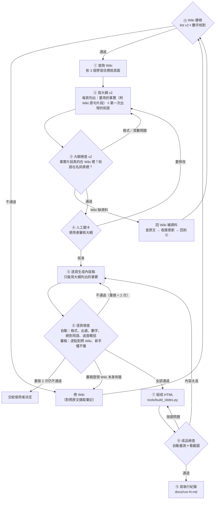

# 簡報流程設計（loop／graph）v2

> 目標：只用 Wiki 的內容，做出 10～12 頁、讓「用過 ChatGPT 的大學生」看得懂的教學簡報。
> 原則：**每一步都有檢查；沒通過就回到出問題的那一步，而且只重做那一部分。**
> v2 是看完 [run-1 的紀錄](run-1.md) 之後改的：**把檢查往前移**，並補上 v1 沒有的回頭路。舊版見 [workflow-v1.md](workflow-v1.md)。

## 流程圖

## v1 → v2 改了什麼（依 run-1 的紀錄）

| run-1 發現的問題 | 原本在哪一關才被發現 | v2 把檢查移到哪裡 | 怎麼檢查 |
|---|---|---|---|
| 簡報需要的資訊 Wiki 根本沒有（05 的設計階段） | ⑥ 審稿（頁面都寫完了） | **③ 大綱**：每頁先列出要用的事實，附上 Wiki 原句片段 | `check_outline.py` 確認片段真的在 Wiki 裡；缺就走「回 Wiki 補資料」 |
| Wiki 的「例子」是自己編的、Wiki 寫錯 | ⑥ 審稿時碰巧發現 | **⓪ 做簡報之前的 Wiki 健檢** | `lint_wiki.py` v2：「例子」也要有出處，或標（整理者舉例） |
| 術語沒解釋（prompt、token） | ⑥ 審稿 | **③ 大綱**：每頁列出第一次出現的術語 | 術語必須收在 `wiki/glossary.md` 名詞表 |
| 過度斷言（「一定」）、過度概括（把 ChatDev 的數字寫成通則） | ⑥ 審稿（靠人眼） | **⑥ 自動檢查**先標出來，審稿再判斷 | `check_slides.py` v2：絕對用語警告；數字在 Wiki 裡屬於某個系統、簡報卻沒寫出系統名時警告 |
| 版面問題（字太小、疊字） | ⑧ 只能靠看截圖；v1 的回頭路只有「改內容」 | **⑧ 固定加上「看截圖」**；新增「版面問題 → 回 ⑦」 | `check_render.py` 自動產生截圖總表 |
| 檢查工具自己有 bug | ⑥（誤報 8 頁） | **工具上線前** | 新工具先用故意出錯的樣本測過，確認抓得到也不會誤報 |

## 檢查關卡（v2）

| 關卡 | 檢查什麼 | 怎麼檢查 | 不通過時 | 上限 |
|---|---|---|---|---|
| ⓪ Wiki 健檢 | 壞連結、缺出處（含例子）、代號、數字和原文一致 | `lint_wiki.py`、`check_numbers.py` | 修 Wiki | — |
| ③ 大綱檢查 | 頁數、出處存在、3 個目標都有負責頁；**事實片段在 Wiki 裡**；**術語在名詞表** | `check_outline.py` v2 | 格式問題回 ②；缺資料回 Wiki | 2 次 |
| ④ 人工關卡 | 主線、份量、有沒有漏 | 使用者 | 回 ② | — |
| ⑥ 逐頁檢查 | 格式、出處、數字；**絕對用語、過度概括警告** | `check_slides.py` v2＋審稿 | 只重做那一頁；Wiki 有錯就回去修 | 2 次 |
| ⑧ 成品檢查 | 超出畫面、翻頁、JS 錯誤；**截圖目視** | `check_render.py`＋看截圖總表 | 內容太長回 ⑤；版面回 ⑦ | 2 次 |

## 哪些步驟會重複（loop）

1. **Wiki 迴圈**：⓪ → 修 Wiki → ⓪，直到健檢通過；大綱或審稿發現 Wiki 有洞或有錯，也回到這裡。
2. **大綱迴圈**：② → ③／④ → ②。
3. **逐頁迴圈**：⑤ → ⑥ 對每一頁跑一次，沒過只重做那一頁。
4. **成品迴圈**：⑧ → ⑤（內容）或 ⑦（版面）→ ⑧。

## 停止條件

- 每個迴圈最多重做 2 次，還不過就交給使用者決定。
- ⑧ 自動檢查和看截圖都通過，才算完成一次執行。

## 為什麼這樣設計

- **錯誤越晚發現，要重做的越多。** run-1 中 7 個審稿問題，有 2 個的根源在 Wiki，等到逐頁審稿才發現時頁面已經寫好了。v2 在寫任何一頁之前，先確認「要用的事實都在 Wiki 裡」。
- **能自動檢查的就不要靠運氣。** 「例子沒出處」「過度概括」在 run-1 是審稿時碰巧看到；v2 讓程式先標出來，審稿只需要判斷。
- **檢查工具也會錯。** run-1 的 8 個誤報來自工具 bug，所以 v2 規定新工具先用故意出錯的樣本測過。
- **回頭路要畫完整。** v1 只有「改內容」一條回頭路，但實際上問題可能出在 Wiki（更前面）或版型（更後面）。
